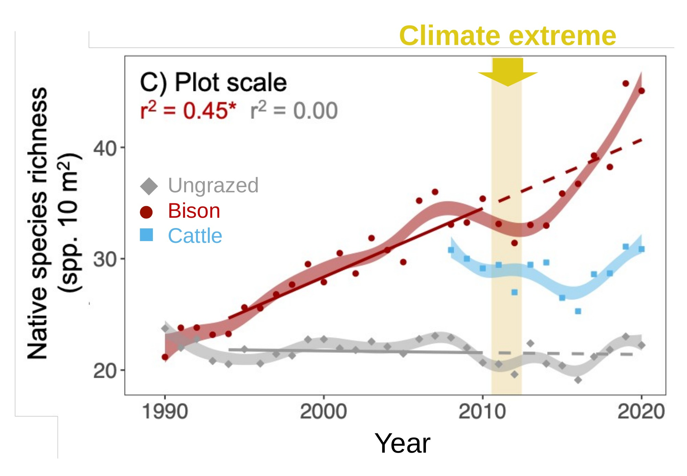
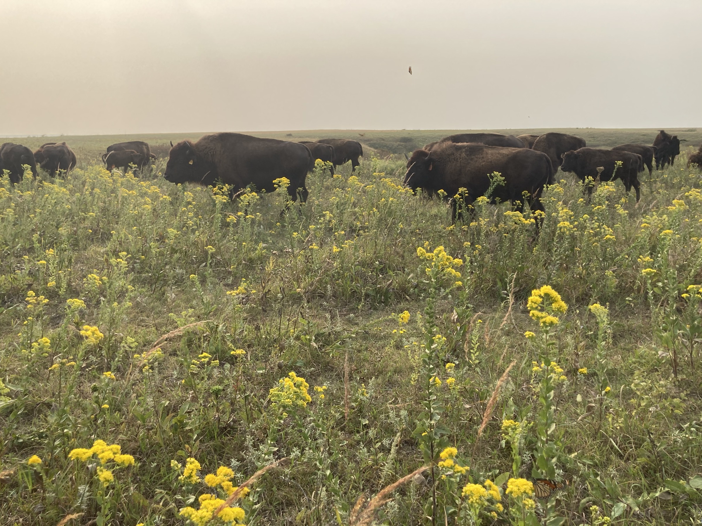
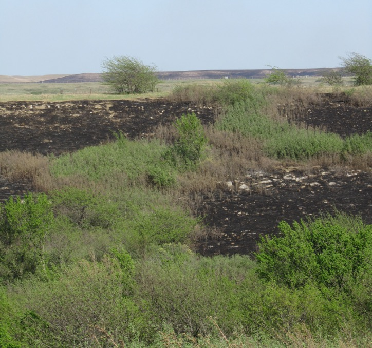

<div>

[All research topics](research.html){.back-link}

# Community ecology and biodiversity

To understand how global change affects grasslands, we draw on community ecology theory, especially the roles of disturbance and dominant species. Bison, for instance, can act as keystone consumers: by grazing dominant grasses they can give plants with different resource needs more opportunity to coexist, and by removing fuel they can also change how often and how intensely a patch burns. Our primary focus is on plants, but graduate students and collaborators have led related work on pollinators, birds, and small mammals.

## Recurring themes

-   Shifts in dominant species can reshape communities. As strong competitors such as tall grasses or woody plants become more abundant, grassland plant diversity often declines sharply.
-   Habitat heterogeneity created by grazers and localized disturbances.
-   Following a change in disturbance, grassland communities can take years to decades to reach a new state---we refer to this as long transients.

## Representative papers

-   Bison, plant diversity, and drought resilience: [Ratajczak et al. (2022)](https://doi.org/10.1073/pnas.2210433119) (bison reintroduction in tallgrass prairie) and [Bookout et al. (2025)](https://doi.org/10.1016/j.biocon.2025.111088) (drought in grazed and ungrazed grasslands).
-   Woody encroachment and biodiversity: [Ratajczak et al. (2012)](https://doi.org/10.1890/11-1199.1) (plants), [Hope et al. (2026)](https://doi.org/10.1002/ece3.72982) (small mammals), and [Silber et al. (2024)](https://doi.org/10.1002/eap.2954) (grassland birds).
-   Grazing and encroachment: [Noble, Ratajczak & Noble (2025)](https://doi.org/10.1002/eap.70108) (bison and eastern redcedar); Noble & Ratajczak (2026), Natural Areas Journal (bison and cattle in mixed-grass prairie).
-   Simulation models: [Ratajczak et al. (2017)](https://doi.org/10.1007/s10021-017-0110-7) (coexistence of grasses and savanna trees).
-   Grazing and pollinator communities: [Greenlee's MS thesis](https://hdl.handle.net/2097/47051).

::::::::::: {.carousel role="region" aria-roledescription="carousel" aria-label="Images from this research"}

```{=html}
<p class="gallery-label">Images from this research</p>
```


:::::::::: carousel-window
::::::::: carousel-track
:::: carousel-slide

```{=html}

```


::: slide-caption
**Bison and plant diversity through drought**

Native plant richness increased over decades following bison reintroduction. Those gains proved resilient to the most extreme drought in 40 years, although the community changed during and after it. This comparison comes from upland tallgrass prairie at Konza. Ratajczak et al. (2022), PNAS.
:::
::::

:::: carousel-slide

```{=html}

```


::: slide-caption
**Plants that benefit from grazing**

Grazing reduces the dominance of tall grasses, creating opportunities for other plants. These include short grasses, small annuals, and wildflowers that are less palatable to large herbivores. The photo above shows bison in late September among some of the wildflowers they promote the most---late-blooming goldenrods (*Solidago* spp.).
:::
::::

:::: carousel-slide

```{=html}

```


::: slide-caption
**Effects of encroachment on grasslands**

Woody encroachment causes many of the organisms adapted to grasslands to decrease, sometimes rapidly, with evidence for plants, birds, and mammals.
:::
::::
:::::::::
::::::::::


```{=html}
<div class="carousel-controls" hidden><button class="prev" aria-label="Previous image">Previous</button><span class="position" aria-live="polite"></span><button class="next" aria-label="Next image">Next</button><button class="play">Pause slideshow</button><span class="hint">Changes every 10 seconds</span></div>
```

:::::::::::

::: detail-bottom
[Research overview](research.html)[Next: Woody plant encroachment](woody-plant-encroachment.html)[Back to top](community-biodiversity-drivers-and-conservation.html)
:::

</div>
