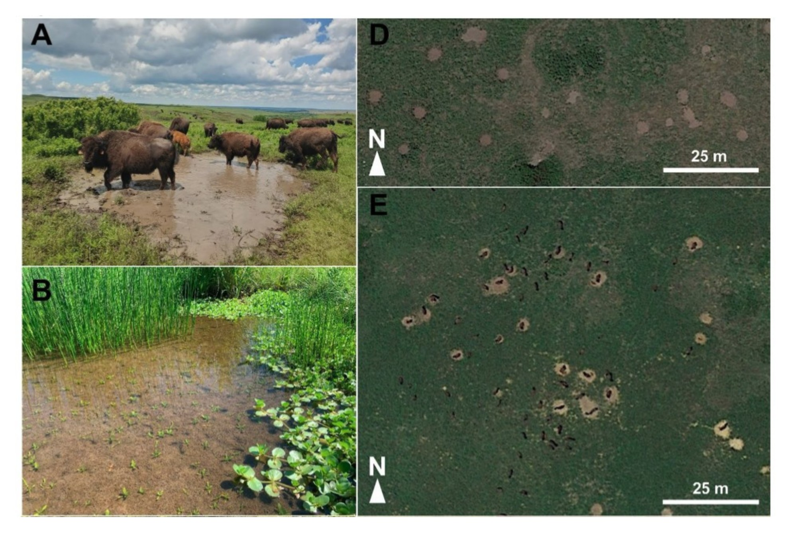
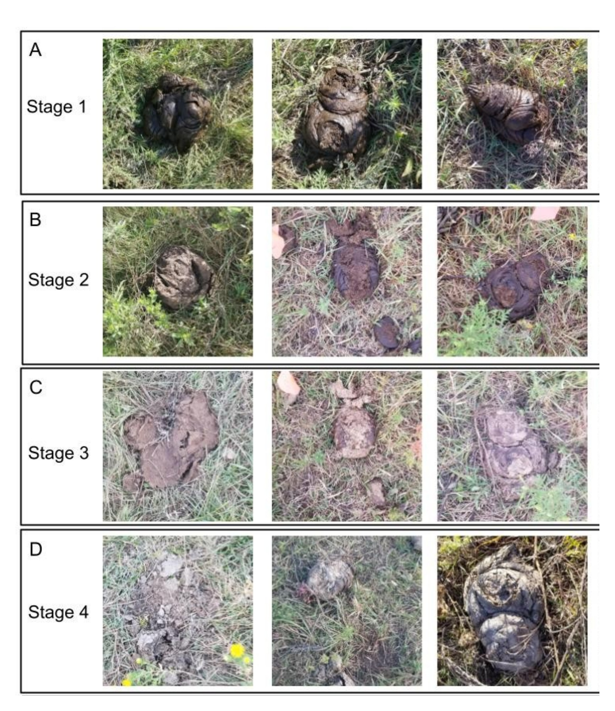
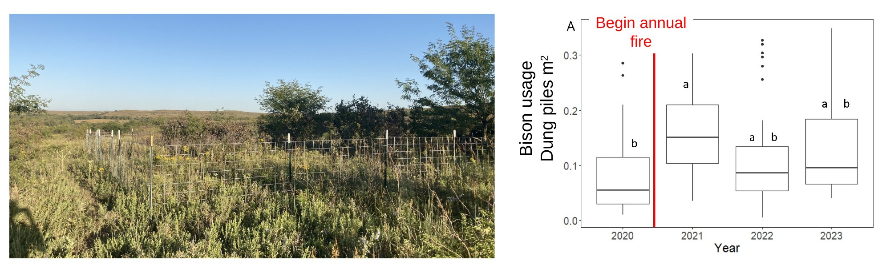

<div>

[All research topics](research.html){.back-link}

# Bison ecology

:::: bison-intro
<div>

Bison reintroduction offers a way to understand how large native herbivores shape grasslands and whether their return can help conserve biodiversity. Long-term experiments at Konza let us follow changes in plant communities, vegetation structure, and responses to drought over decades. Comparisons with cattle-grazed and ungrazed grasslands help identify which effects depend on the grazer and which depend on the setting.

These effects extend beyond the plants bison eat. Grazing changes the fuels available for fire, while trampling and wallowing create patches with different soils, vegetation, and water conditions. Projects across the lab connect these changes to woody plant establishment, pollinator habitat, and the microbial communities found in wallows. A recurring question is when reintroducing bison supports biodiversity and resilience, and where additional management is needed.

We are also asking more questions about the bison themselves: where they spend time after a fire, which patches they return to graze, and whether restoring open vegetation brings them back to areas that have provided poor forage for decades. This connects the ecological effects of bison with the habitat conditions that sustain them.

Grazing lawns are one example. By repeatedly grazing the same patch, bison can keep grasses short and gain access to high-quality regrowth. Wallows are another: the depressions bison create can collect drinking water after rain and, in some soils, access to salts. We are interested in when these changes influence where bison go next.

</div>

::: calf-feature

<p>
```{=html}
<video controls="" playsinline="" preload="none" poster="images/calf-poster.jpg"><source src="images/lab-asset-c27dcdf4.mp4" type="video/mp4"></source></video>
```
</p>
<div class="slide-caption">
<p><strong>An autumn calf</strong></p>
<p>A late-born calf at Konza in autumn 2020. Calves born this late can face a difficult first winter, but this one made it through! Konza’s long-term records of bison weights and births help us study how the herd responds to changing conditions.</p>
</div>

:::

::::

## Representative papers

-   Bison, plant diversity, and drought resilience: [Ratajczak et al. (2022)](https://doi.org/10.1073/pnas.2210433119).
-   Bison and woody vegetation: [Noble, Ratajczak & Noble (2025)](https://doi.org/10.1002/eap.70108); habitat use after restoring frequent fire: [Noble & Ratajczak (2025)](https://doi.org/10.3368/er.43.4.288).
-   Dung as a record of habitat use: [B. Noble & Ratajczak (2023)](https://doi.org/10.1660/062.126.0114). Wallow research: [Bookout's dissertation](https://hdl.handle.net/2097/45247).

<!-- -->

-   Drought resilience in grazed and ungrazed grasslands: [Bookout et al. (2025)](https://doi.org/10.1016/j.biocon.2025.111088).
-   Bison and cattle in mixed-grass prairie at Badlands and Theodore Roosevelt National Parks: [Noble & Ratajczak (2026)](https://doi.org/10.3375/2162-4399-46.1.2).

::::::::::::: {.carousel role="region" aria-roledescription="carousel" aria-label="Images from this research"}

```{=html}
<p class="gallery-label">Images from this research</p>
```


:::::::::::: carousel-window
::::::::::: carousel-track
:::: carousel-slide

```{=html}

```


::: slide-caption
**Bison wallows**

Bison wallows create patches with different soils, plant communities, and water conditions from the surrounding prairie. After rainy periods, some wallows hold water for weeks, supporting wetland biota. Bookout et al., Ecology, pending minor revision.
:::
::::

:::: {.carousel-slide image="ceres-bison-gps"}

```{=html}

```


::: slide-caption
**Tracking bison movement and behavior**

On October 30th 2026 we deployed 28 Ceres GPS tags to help us follow bison movement and behavior at Konza Prairie. This screenshot shows the path of one female bison over the course of a week. The path and time labels have been enhanced for visibility.

Basemap: Mapbox / OpenStreetMap; imagery: Maxar.
:::
::::

:::: carousel-slide

```{=html}

```


::: slide-caption
**Bison dung and habitat use**

We started tracking dung decay to calibrate dung counts as a measure of bison habitat use. The surprise (to us) was that some bison dung persists a surprisingly long time, raising a number of questions, such as whether we are missing certain dung beetles in this system? B. Noble and Ratajczak (2023), Transactions of the Kansas Academy of Science.
:::
::::

:::: carousel-slide

```{=html}

```


::: slide-caption
**Bison habitat use after restoring fire**

One of our 16 fenced exclosures in heavily encroached tallgrass prairie, where paired exclosures help separate the effects of grazing from those of reintroducing frequent fire. Dung counts show increased bison use in the first year after annual burning resumed, which has partially faded in subsequent years. Noble & Ratajczak (2025), Ecological Restoration.
:::
::::
:::::::::::
::::::::::::


```{=html}
<div class="carousel-controls" hidden><button class="prev" aria-label="Previous image">Previous</button><span class="position" aria-live="polite"></span><button class="next" aria-label="Next image">Next</button><button class="play">Pause slideshow</button><span class="hint">Changes every 10 seconds</span></div>
```

:::::::::::::

::: detail-bottom
[Research overview](research.html)[Next: Community ecology and biodiversity](community-biodiversity-drivers-and-conservation.html)[Back to top](fire-and-bison-ecology.html)
:::

</div>
