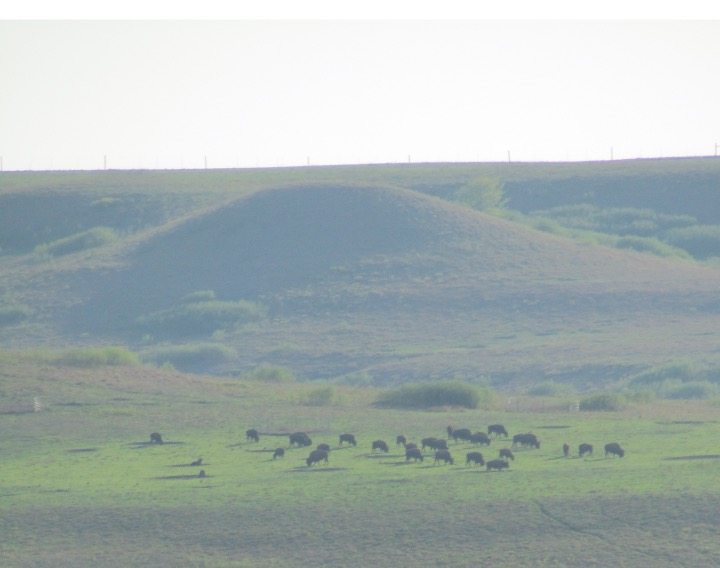

<div>

:::: home-hero

```{=html}

```


::: hero-title
Kansas State University · Division of Biology

# Grassland Resilience Lab

:::

```{=html}
<p class="hero-pi">PI-Zak Ratajczak</p>
```
::::

::: home-intro
Our goal is to better understand the factors that support biodiversity and resilience in grasslands. We examine how fire, grazing, and woody plant encroachment shape these systems, combining theory, field studies, remote sensing and simulations. Our goal is to achieve "applied theory ecology" where we advance general ecological knowledge through projects that also have direct implications for basic ecology, conservation, or management.

[Explore our research](research.html){.learn}
:::

:::::: content-block
::::: home-context
::: {.section .content-block}
## Grasslands

Grasslands can support diverse communities of plants and animals and provide key ecosystem services, including freshwater recharge. Many grasslands also provide the direct benefit of forage for large animals that humans consume. Grasslands can appear quite simple, but are actually quite complex and dynamic. Fire, grazing, and climate interact to shape these communities and the resources they provide. Understanding those interactions is especially relevant as grasslands face land use change, species invasion, and climate change.
:::

::: {.section .content-block}
## The Flint Hills

The Flint Hills contain North America's largest remaining tallgrass prairie landscape. They are also a working landscape, where cattle ranching, prescribed fire, conservation, and culture are closely connected. This makes the region an important place to understand how management shapes biodiversity, vegetation, and ecosystem services---and how ecological research can inform decisions about their future.

Much of our work is based at Konza Prairie, where decades of fire and grazing experiments allow us to follow changes that would be difficult to recognize in a shorter study. That long-term perspective helps us understand both how grasslands persist and why they sometimes change.
:::
:::::

Bison grazing in prairie.
::::::

[Back to top](index.html)

</div>
