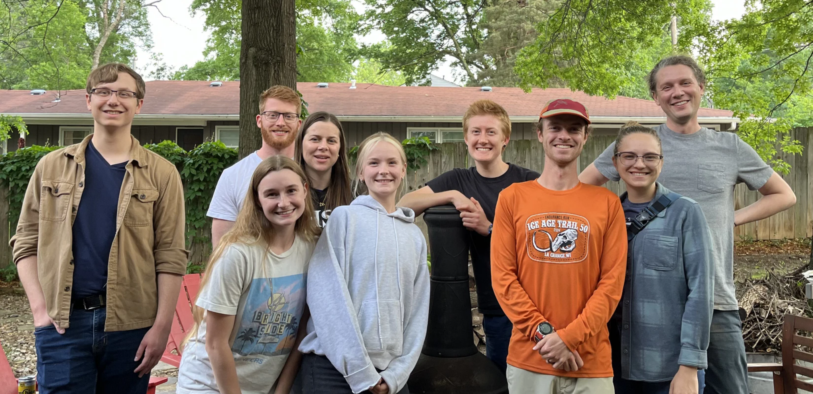
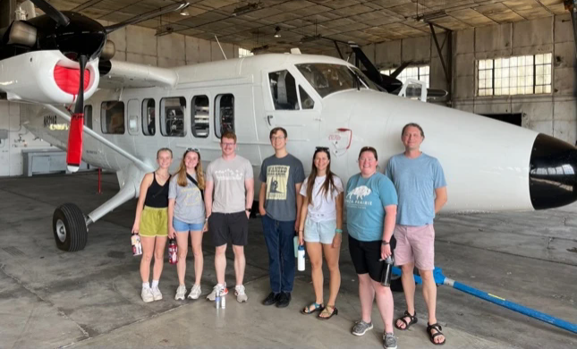
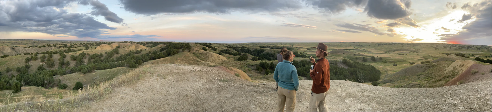
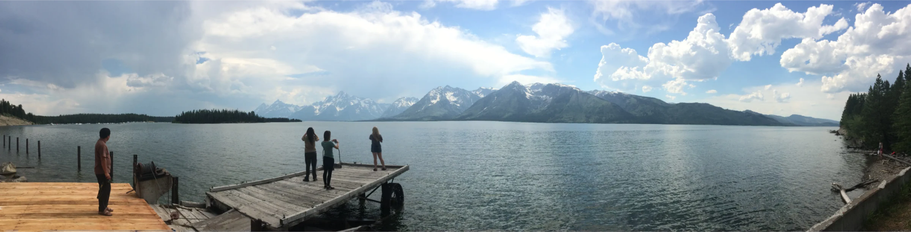
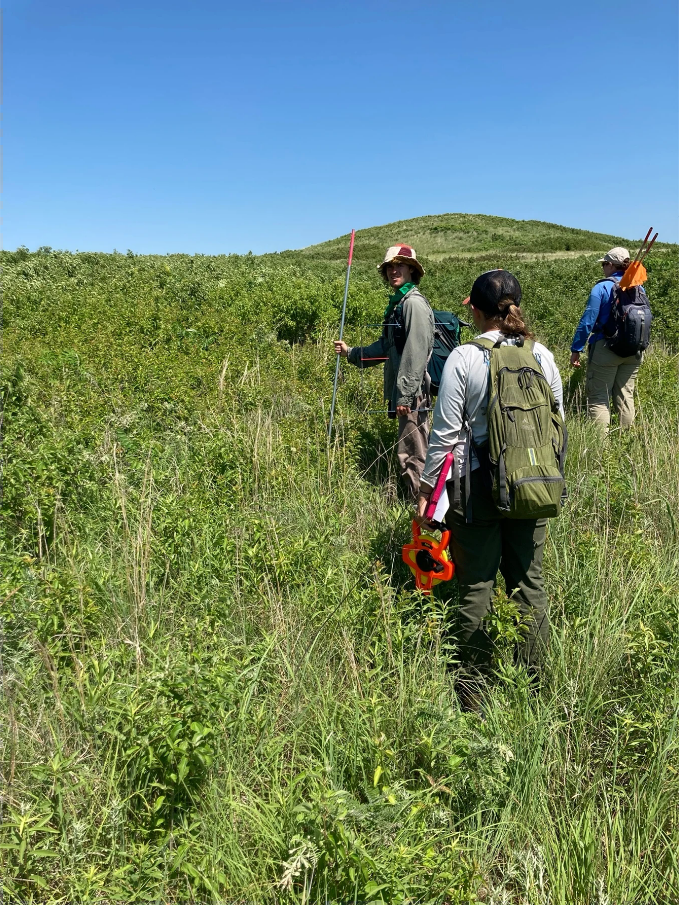

<div>

# People

::::::::::::::: {.carousel role="region" aria-roledescription="carousel" aria-label="Around the lab and in the field"}

```{=html}
<p class="gallery-label">Around the lab and in the field</p>
```


:::::::::::::: carousel-window
::::::::::::: carousel-track
:::: {.carousel-slide people-photo="1"}

```{=html}

```


::: slide-caption
Most of the lab, circa 2024. Left to right: Chase Glasscock, Abby Schmidt, Luke Carney, Kalea Nippert-Churchman, Klara Stevermer, Emma Greenlee, Sidney Noble, Brynn Noble, and Zak Ratajczak. Sorry we missed you in this one, Bess Bookout!
:::
::::

:::: {.carousel-slide people-photo="2"}

```{=html}

```


::: slide-caption
A few of us visiting the NEON AOP aircraft. We make extensive use of the lidar data it collects. We do not, however, fly the plane---that would be ill-advised!

Left to right: Klara Stevermer, Abby Schmidt, Luke Carney, Chase Glasscock, Kalea Nippert-Churchman, Bess Bookout, and Zak Ratajczak.
:::
::::

:::: {.carousel-slide people-photo="3"}

```{=html}

```


::: slide-caption
Brynn Noble (left) and Sidney Noble (right) on an evening break from fieldwork in Badlands National Park.
:::
::::

:::: {.carousel-slide people-photo="4"}

```{=html}

```


::: slide-caption
A view from Jackson Lake during fieldwork in Grand Teton and Yellowstone National Parks.
:::
::::

:::: {.carousel-slide people-photo="5"}

```{=html}

```


::: slide-caption
Some grueling shrub-encroachment fieldwork with Sidney Noble, Brynn Noble, and Bess Bookout (left to right).
:::
::::
:::::::::::::
::::::::::::::


```{=html}
<div class="carousel-controls" hidden><button class="prev" aria-label="Previous image">Previous</button><span class="position" aria-live="polite"></span><button class="next" aria-label="Next image">Next</button><button class="play">Pause slideshow</button><span class="hint">Changes every 10 seconds</span></div>
```

:::::::::::::::

:::: faculty-profile
::: {.section .content-block}
## Zak Ratajczak

Associate Professor · Division of Biology · Kansas State University

I am an ecologist with a varied background, but an emphasis on community and landscape ecology. I'm deeply interested in advancing ecological concepts and theory, but equally motivated to do research that makes meaningful contributions to conservation. This could easily spread us too thin, but we design most projects to try and meet both of these goals at once. Along with my role as a teacher, researcher, and mentor, a growing part of my work is outside of academia through public engagement.

I studied biology and earth science at Vassar College and earned a PhD in Biology at Kansas State. Before becoming a faculty member, I worked with mathematicians, social scientists, and forest ecologists during postdoctoral appointments at the University of Virginia, the London School of Economics, and the University of Wisconsin--Madison.

Outside work, I enjoy traveling, hiking, and vegetable gardening.

[Download CV (PDF)](files/ratajczak-fullcv-v3-pdf-f8afd99c.pdf){download="Zak_Ratajczak_CV.pdf"}   [Email Zak](mailto:zarata@ksu.edu)
:::
::::

## Graduate alumni

-   **Bess Bookout** · PhD, 2025\
    Bison wallows and grassland plant communities under drought.

    [Dissertation: Bison as ecosystem engineers: impacts on tallgrass prairie soil, plant communities, and microbial assemblages](https://hdl.handle.net/2097/45247)

    Now a Teaching Assistant Professor at Kansas State University.

-   **Emma Greenlee** · MS, 2025\
    Pollinator communities in grasslands used by large herbivores.

    [Thesis: Grazing for pollinators: the effects of grazing management on foraging and nesting pollinator communities and habitat](https://hdl.handle.net/2097/47051)

    Now at Midwest Natural Resources.

-   **Sidney Noble** · PhD, 2024\
    Bison grazing, plant diversity, and woody encroachment.

    [Dissertation: North American megafauna, friend or foe to woody encroachment across the Great Plains? Further exploring the American bison's ecological role on plant communities](https://hdl.handle.net/2097/44431)

    Now at U.S. Forest Service.

-   **Brynn Noble (Ritchey)** · MS, 2023\
    Mapping shrubs and trees in tallgrass prairie using aerial imagery and lidar.

    [Thesis: Early detection of wildfire risk in the Great Plains: merging machine learning, landscape metrics, and rich data sources](https://hdl.handle.net/2097/43444)

    Now at U.S. Geological Survey.

## Undergraduate research advisees

Independent studies, honors research, and Research Experiences for Undergraduates (REU).

-   **Kiranne Smith** · 2026 · Independent study
-   **Luke Carney** · 2025 · Independent study
-   **Jamie Parriot** · 2025 · Independent study
-   **Klara Stevermer** · 2024 · Independent study
-   **Abigail Schmidt** · 2023 · REU and independent study
-   **Audrey Van Zelfden** · 2023 · REU
-   **McKenna John** · 2022 · Honors research
-   **Kalea Nippert** · 2022 · REU and independent study
-   **Khyla Johnson** · 2021 · REU

[Back to top](people.html)

</div>
