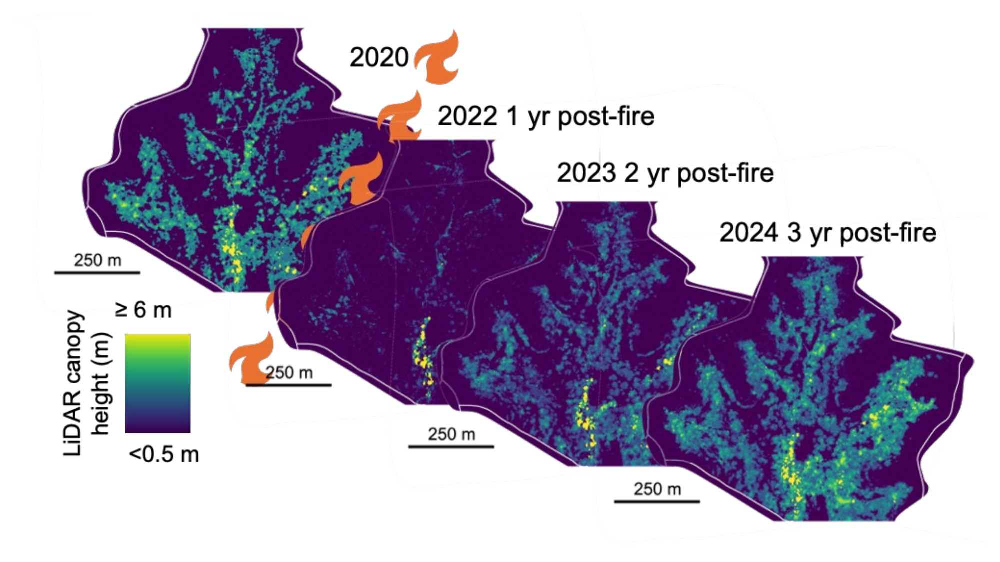
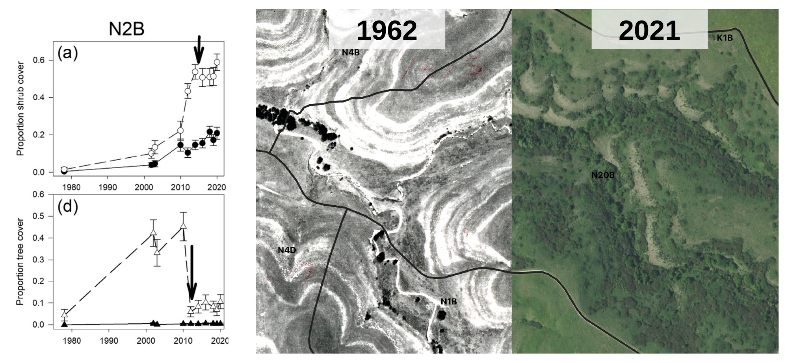
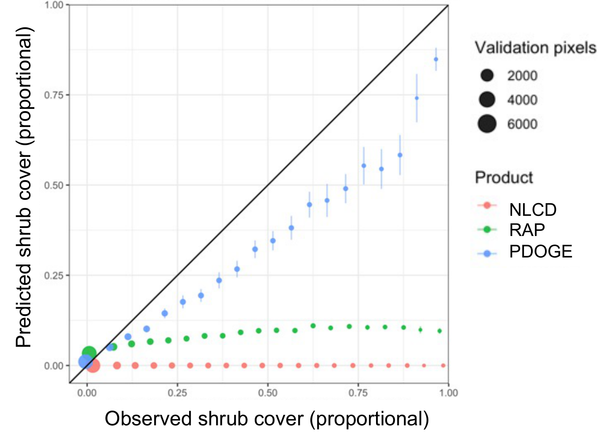

<div>

[All research topics](research.html){.back-link}

# Remote sensing of large-scale, long-term change

Remote sensing is drastically increasing the scope of how we measure land cover change. High-resolution imagery, paired with field-based training data and machine learning, is allowing us to measure encroachment with high accuracy at large spatial extents. Historical aerial photographs extend our view to conditions before modern satellite records.

We're now at the stage of using these sources to link up with satellite data, with the aim of extending to the Flint Hills ecoregion. This would meet two goals: 1) develop the ability to detect incipient woody expansion early enough for land managers to intervene when shrubs are small, and much easier to control. 2) Most national- and world-scale remote sensing consistently undercounts shrub land cover, especially once at moderate to severe encroachment. Therefore, we are hoping to achieve better accuracy, because we strongly suspect woody encroachment is removing more habitat, forage, and water than currently recognized.

## Recurring themes

-   High-resolution imagery as a way to scale our monitoring and make cross scale connections.
-   Reconstructing vegetation history from old aerial photographs and long-term field records.
-   Detecting woody establishment and expansion before management options narrow.
-   Linking vegetation change with water resources and habitat.

## Representative findings and papers

-   Interpreting aerial photographs: [Keen et al. (2023)](https://doi.org/10.1007/s10021-022-00756-7) and [Dodds et al. (2023)](https://doi.org/10.1002/eap.2830) (woody vegetation and prairie watersheds).
-   High-resolution measurements of woody vegetation: [Noble & Ratajczak (2025)](https://doi.org/10.3390/rs17132224) (mapping vegetation cover) and [Nippert-Churchman et al. (2026)](https://doi.org/10.1002/eap.70341) (shrub height after fire).
-   Extension to satellite-based remote sensing---unpublished, but see images below.

::::::::::: {.carousel role="region" aria-roledescription="carousel" aria-label="Images from this research"}

```{=html}
<p class="gallery-label">Images from this research</p>
```


:::::::::: carousel-window
::::::::: carousel-track
:::: carousel-slide

```{=html}

```


::: slide-caption
**Shrub recovery measured with lidar**

High-intensity fire top-killed most shrub stems in watershed 4B at Konza. However, two years later robust resprouting led to nearly full recovery of shrub height and an increase in woody cover. Repeated LiDAR measurements let us follow this recovery across the watershed. Adapted from Nippert-Churchman et al. (2026), Ecological Applications.
:::
::::

:::: carousel-slide

```{=html}

```


::: slide-caption
**Historical aerial imagery**

Aerial photographs from 1962 and 2021 show changes in woody vegetation at Konza. We have been using these images to reconstruct patterns of land-cover change where we lack long-term on-the-ground data. See Keen et al. (2022) and Dodds et al. (2023) for some of this kind of work we've done with these aerial images.
:::
::::

:::: carousel-slide

```{=html}

```


::: slide-caption
**Comparing land-cover models**

This figure shows the current performance of our model PDOGE (Precision Detection of Grassland Encroachment) compared to commonly used landcover models, NLCD (National Land Cover Database) and Rangeland Analysis Platform (RAP). This graph shows shrub cover across a range of validation watersheds that total 12,473 30 x 30 m pixels.
:::
::::
:::::::::
::::::::::


```{=html}
<div class="carousel-controls" hidden><button class="prev" aria-label="Previous image">Previous</button><span class="position" aria-live="polite"></span><button class="next" aria-label="Next image">Next</button><button class="play">Pause slideshow</button><span class="hint">Changes every 10 seconds</span></div>
```

:::::::::::

::: detail-bottom
[Research overview](research.html)[Next: Social-ecological systems](social-ecological-systems.html)[Back to top](remote-sensing-of-large-scale-long-term-change.html)
:::

</div>
