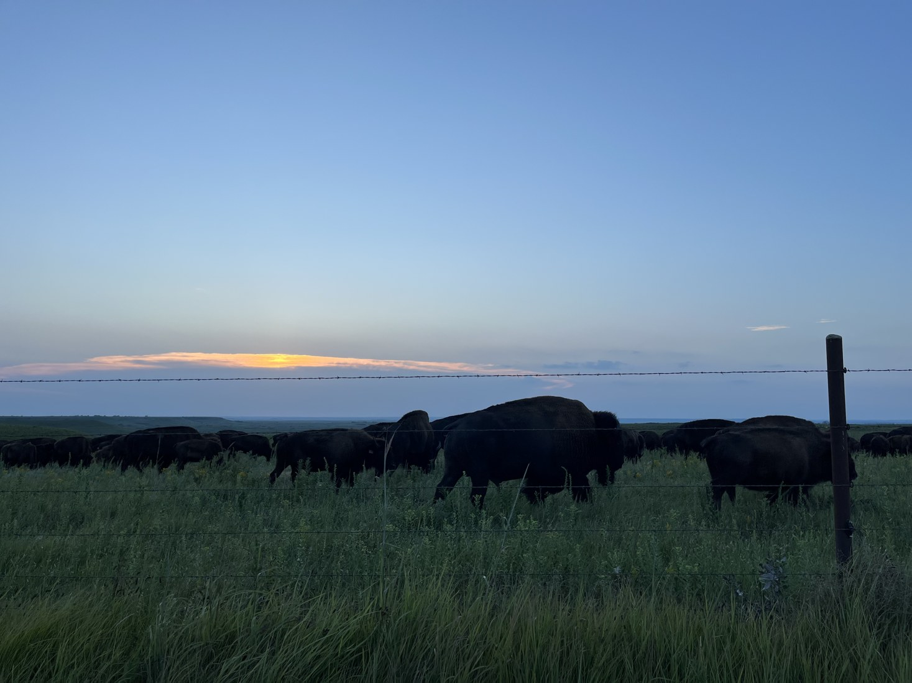
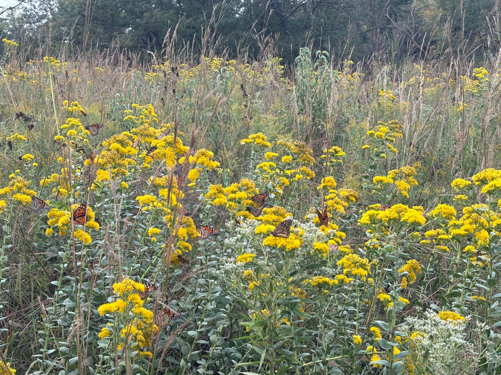
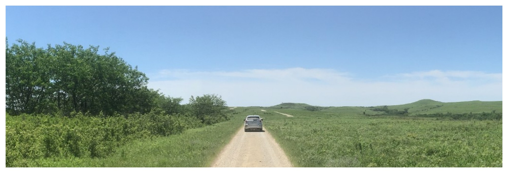
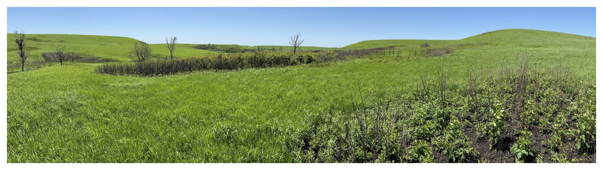
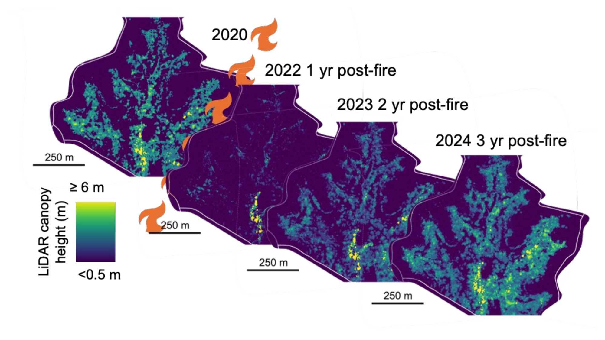
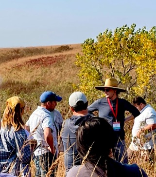

<div>

::: page-intro
# Research
:::

::::: topic-panel
::: panel-image

```{=html}

```

:::

::: panel-text
## [Fire and bison ecology](fire-and-bison-ecology.html)

Fire and bison shape prairie vegetation, while the resulting patches influence bison habitat choice. Our work follows these interactions, with the goal of reaching a better "whole system" understanding of tallgrass prairies.

[Click here to learn more []{aria-hidden="true"}](fire-and-bison-ecology.html){.learn aria-label="Learn more about Fire and bison ecology"}
:::
:::::

::::: topic-panel
::: panel-image

```{=html}

```

:::

::: panel-text
## [Community ecology and biodiversity](community-biodiversity-drivers-and-conservation.html)

Grassland diversity depends on interactions among disturbance, dominant species, and habitat. Our research examines how fire, grazing, and woody encroachment affect plant and animal communities.

[Click here to learn more []{aria-hidden="true"}](community-biodiversity-drivers-and-conservation.html){.learn aria-label="Learn more about Community ecology and biodiversity"}
:::
:::::

::::: topic-panel
::: panel-image

```{=html}

```

:::

::: panel-text
## [Woody plant encroachment](woody-plant-encroachment.html)

Shrubs and trees are expanding into grasslands around the world, and in the process drastically altering biota and ecosystem function. A central question is how competition, clonal growth, and feedbacks with fire allow woody plants to spread and persist---and where management can interrupt those processes.

[Click here to learn more []{aria-hidden="true"}](woody-plant-encroachment.html){.learn aria-label="Learn more about Woody plant encroachment"}
:::
:::::

::::: topic-panel
::: panel-image

```{=html}

```

:::

::: panel-text
## [Resilience and restoration](restoration-and-resilience.html)

What allows an ecosystem to persist through disturbance, and what makes recovery possible after drastic shifts between alternative states? Work in this area includes both measures of ecological resilience, and frameworks to help make such measurements.

[Click here to learn more []{aria-hidden="true"}](restoration-and-resilience.html){.learn aria-label="Learn more about Resilience and restoration"}
:::
:::::

::::: {.topic-panel .figure-panel}
::: panel-image

```{=html}

```

:::

::: panel-text
## [Remote sensing and scaling](remote-sensing-of-large-scale-long-term-change.html)

Remote sensing is a growing part of our portfolio. High resolution allows us to measure the effects of large-scale experiments in new ways. Work with historical aerial images is allowing us to reconstruct patterns of landscape change over time. And working with satellite data is scaling our inference across space and time---including potential early detection of landcover change.

[Click here to learn more []{aria-hidden="true"}](remote-sensing-of-large-scale-long-term-change.html){.learn aria-label="Learn more about Remote sensing and scaling"}
:::
:::::

::::: {.topic-panel .figure-panel}
::: panel-image

```{=html}

```

:::

::: panel-text
## [Social-ecological systems](social-ecological-systems.html)

Humans are a fundamental component of nearly all ecosystems. One of our goals is to build frameworks that make it easier to integrate information on ecological resilience into decision making. This has included grassland management, wildfire, and food systems.

[Click here to learn more](social-ecological-systems.html){.learn}
:::
:::::

[Back to top](research.html)

</div>
