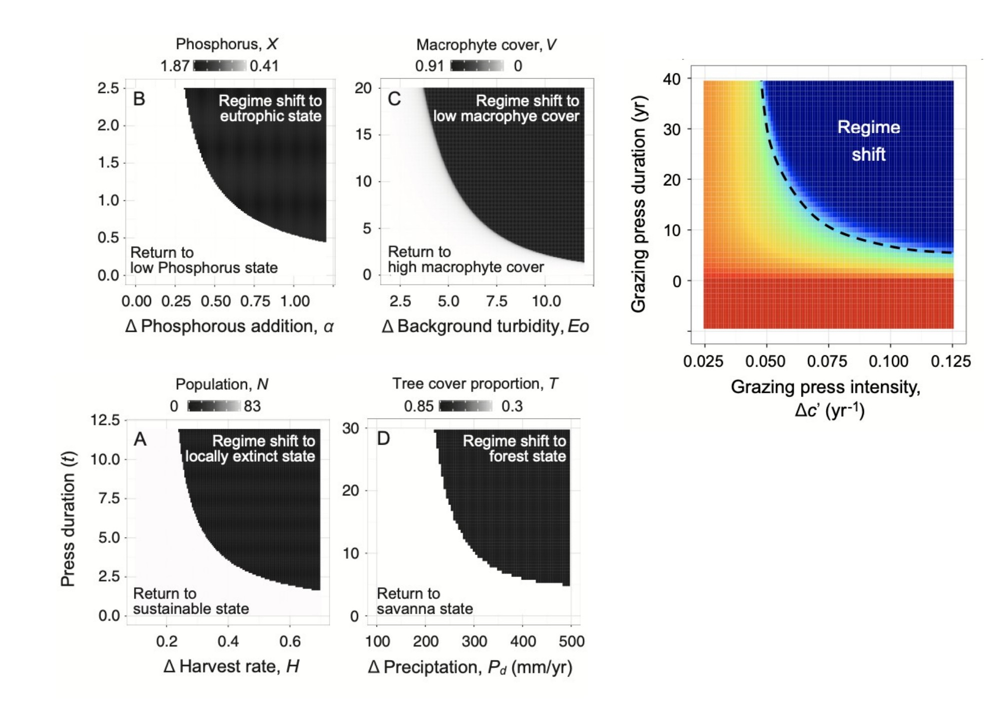
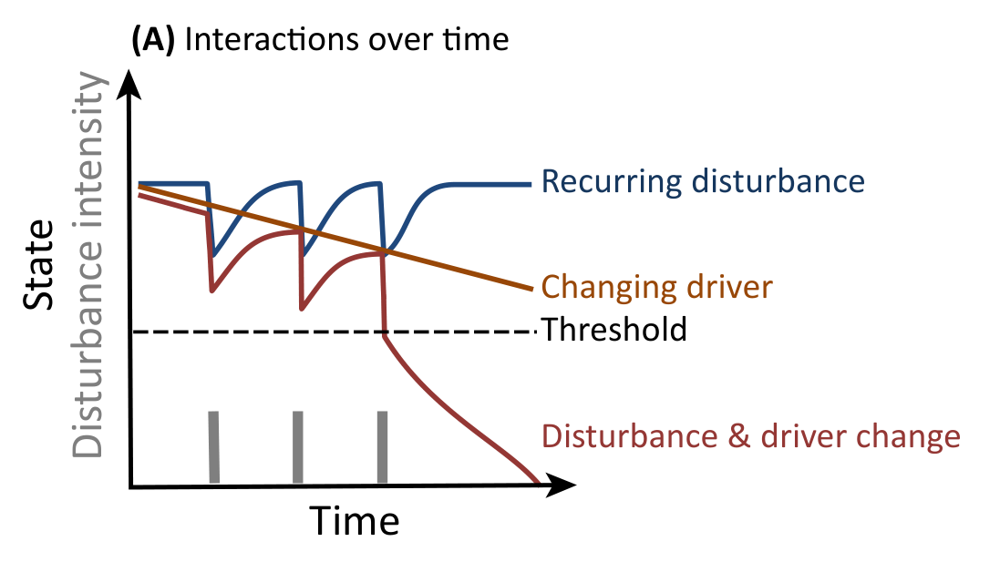

<div>

[All research topics](research.html){.back-link}

# Resilience and restoration

Ecological resilience is the ability to withstand changing drivers and disturbances without making a major shift to a new alternative state. Despite this simple definition, applying resilience and related concepts has proven quite difficult.

## Understanding tipping points

Applying resilience concepts to real ecosystems requires deciding what would count as evidence for a tipping point, how long a transition could take, and what allows recovery. Work across grasslands, forests, and other systems combines models with time series and spatial surveys. Seeds, buds, and other sources of regeneration can help explain why similar disturbances produce different outcomes.

## Representative papers

-   Tipping points and abrupt change: [Ratajczak et al. (2018)](https://doi.org/10.1016/j.tree.2018.04.013) and [Turner et al. (2020)](https://doi.org/10.1098/rstb.2019.0105).
-   Seed banks: [Ma et al. (2021)](https://doi.org/10.1093/biosci/biab011).
-   Forest regeneration: [Ramiadantsoa et al. (2023)](https://doi.org/10.1002/ecy.4041).
-   Press/pulse duration and transient dynamics: [Ratajczak et al. (2017), Ecological Monographs](https://doi.org/10.1002/ecm.1249). Forest resilience models: [Albrich et al. (2020)](https://doi.org/10.1111/geb.13197).
-   Evidence from spatial and temporal records: [Ratajczak et al. (2017), Journal of Ecology](https://doi.org/10.1111/1365-2745.12696), [Stegner et al. (2019)](https://doi.org/10.1016/j.quascirev.2019.01.009), and [Chen et al. (2026)](https://doi.org/10.1111/2041-210X.70343).

::::::::: {.carousel role="region" aria-roledescription="carousel" aria-label="Images from this research"}

```{=html}
<p class="gallery-label">Images from this research</p>
```


:::::::: carousel-window
::::::: carousel-track
:::: carousel-slide

```{=html}

```


::: slide-caption
**Driver intensity and duration**

An ecosystem's response depends on how strongly a driver changes and how long that change lasts. Models across several systems show combinations that allow recovery and others that lead to a shift in state. Ratajczak et al. (2017), Ecological Monographs.
:::
::::

:::: carousel-slide

```{=html}

```


::: slide-caption
**Changing drivers and recurring disturbance**

A changing driver or recurring disturbance alone need not cause a state transition. Together, they can push an ecosystem across a threshold and prevent recovery. From [Ratajczak et al. (2018)](https://doi.org/10.1016/j.tree.2018.04.013), Figure 5A.
:::
::::
:::::::
::::::::


```{=html}
<div class="carousel-controls" hidden><button class="prev" aria-label="Previous image">Previous</button><span class="position" aria-live="polite"></span><button class="next" aria-label="Next image">Next</button><button class="play">Pause slideshow</button><span class="hint">Changes every 10 seconds</span></div>
```

:::::::::

::: detail-bottom
[Research overview](research.html)[Next: Remote sensing of large-scale, long-term change](remote-sensing-of-large-scale-long-term-change.html)[Back to top](restoration-and-resilience.html)
:::

</div>
