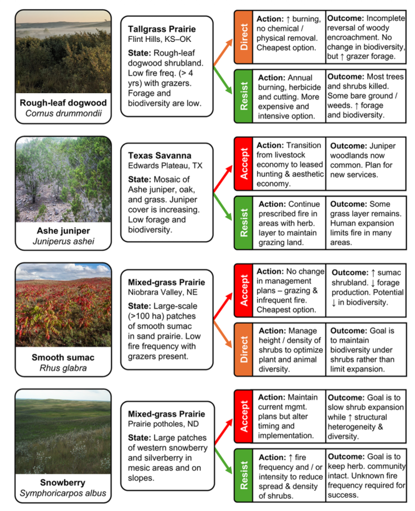
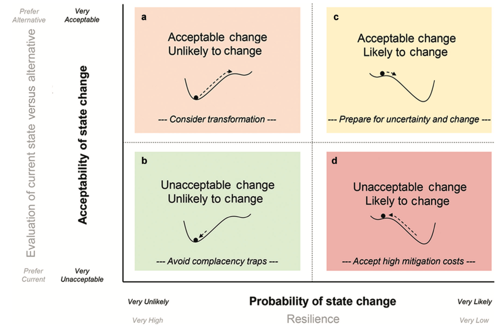
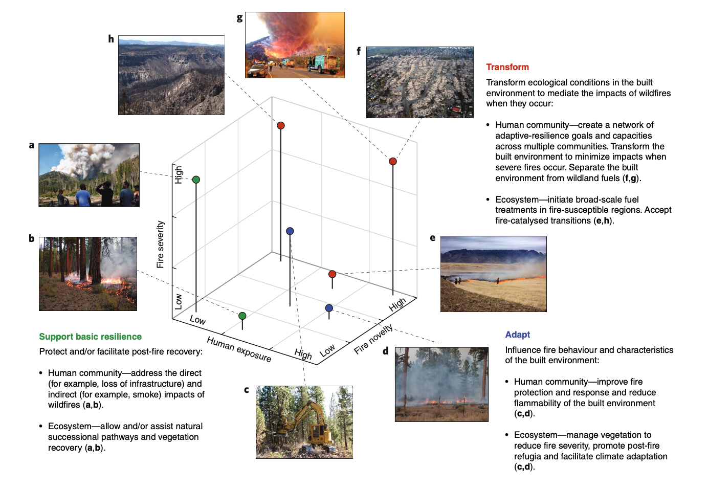
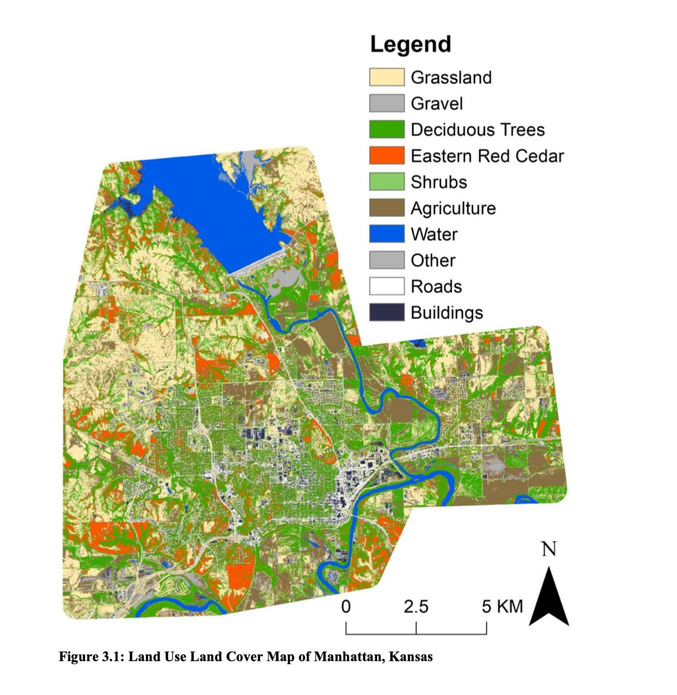
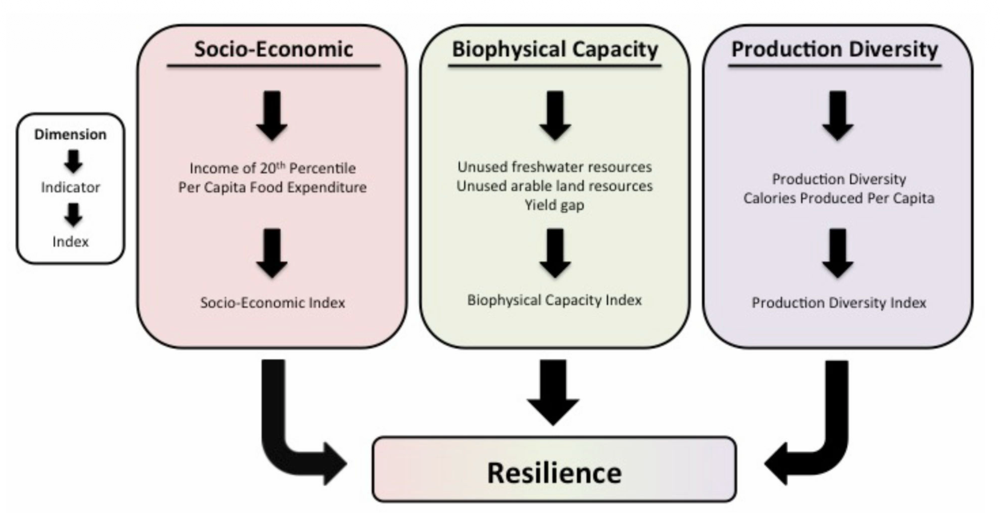

<div>

[All research topics](research.html){.back-link}

# Social-ecological systems

Resilience is hard to measure even when the question is purely ecological. Using it to make a decision raises other questions: Which changes matter most to the people managing a place? What options do they have if those changes occur? We have worked to develop frameworks and heuristics that incorporate information on ecological resilience in this type of decision making. In the Great Plains, we also spend time with land managers and grassland enthusiasts to understand what they are trying to maintain and new management options that are on the table. Those conversations help us ask better questions about fire, grazing, and grasslands in general.

## Representative papers

-   Grassland management and the resist--accept--direct framework: [Nippert et al. (2026)](https://doi.org/10.1093/biosci/biag033).
-   Wildfire and the wildland--urban interface: [Higuera et al. (2019)](https://doi.org/10.1093/biosci/biz030) and [McWethy et al. (2019)](https://doi.org/10.1038/s41893-019-0353-8).
-   Resilience in food systems: [Marchand et al. (2016)](https://doi.org/10.1088/1748-9326/11/9/095009), [Fader et al. (2016)](https://doi.org/10.1088/1748-9326/11/5/055008), and [Seekell et al. (2017)](https://doi.org/10.1088/1748-9326/aa5730).

::::::: {.carousel role="region" aria-roledescription="carousel" aria-label="Social-ecological systems figures"}
```{=html}
<p class="gallery-label">Images from this research</p>
```
:::::: carousel-window
::::: carousel-track
:::: carousel-slide
```{=html}

```

::: slide-caption
**Resist, accept, or direct woody encroachment**

Examples across the Great Plains show how the resist--accept--direct framework can clarify management options, their costs, and their ecological outcomes. [Nippert et al. (2026), BioScience](https://doi.org/10.1093/biosci/biag033).
:::
::::

:::: carousel-slide
```{=html}

```

::: slide-caption
**Resilience and the desirability of change**

The likelihood of ecological change and its acceptability to people are separate questions. Transformation can sometimes be desirable; in other cases, maintaining the current state can require costly intervention. [Higuera et al. (2019)](https://doi.org/10.1093/biosci/biz030).
:::
::::

:::: carousel-slide
```{=html}

```

::: slide-caption
**Responding to changing wildfire regimes**

Case studies connect fire severity, human exposure, and fire novelty to three broad responses: supporting basic resilience, adapting, and transforming. [McWethy et al. (2019)](https://doi.org/10.1038/s41893-019-0353-8).
:::
::::

:::: carousel-slide
```{=html}

```

::: slide-caption
**Mapping land cover around Manhattan**

We combine machine learning with high-resolution aerial imagery to map land cover around Manhattan, Kansas. These maps help us assess wildfire risk where homes and grasslands meet and consider which management responses may be effective. From Brynn Noble's MS thesis; manuscript in revision.
:::
::::

:::: carousel-slide
```{=html}

```

::: slide-caption
**Food-system resilience**

Indicators of national food-system resilience combine socioeconomic access, biophysical capacity, and production diversity. Each dimension contributes to an index for comparing resilience across nations. [Seekell et al. (2017)](https://doi.org/10.1088/1748-9326/aa5730).
:::
::::

:::::
::::::
```{=html}
<div class="carousel-controls" hidden><button class="prev" aria-label="Previous image">Previous</button><span class="position" aria-live="polite"></span><button class="next" aria-label="Next image">Next</button><button class="play">Pause slideshow</button><span class="hint">Changes every 10 seconds</span></div>
```
:::::::

::: detail-bottom
[Research overview](research.html)[Back to top](social-ecological-systems.html)
:::

</div>
