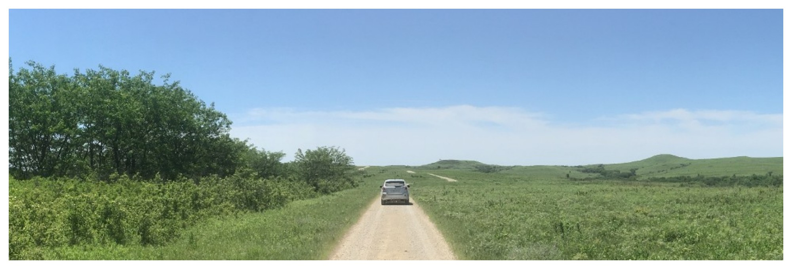
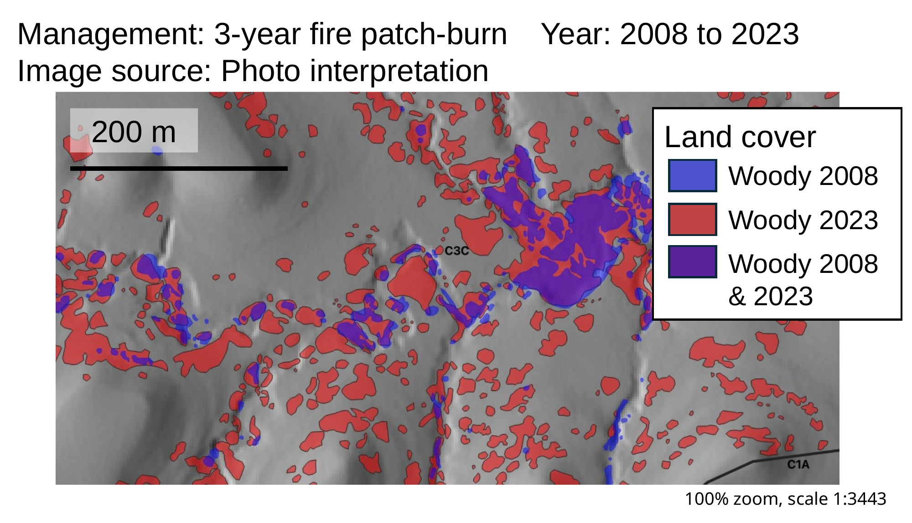
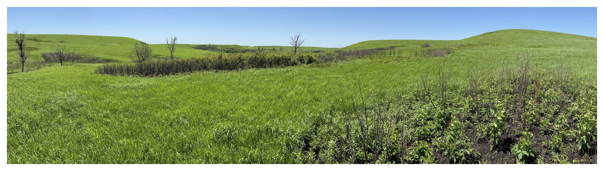

<div>

[All research topics](research.html){.back-link}

# Woody plant encroachment

Invasive species are widely recognized as a major conservation threat. In grasslands around the world, expanding shrubs and trees, many of them native, are also changing biodiversity and key ecosystem functions. Understanding this expansion requires looking at the push and pull between grasses and woody plants, from competition among neighboring plants to the spread of shrubs across a landscape.

Both grasses and shrubs can be strong competitors once they become dominant. Grasses compete effectively for resources in the upper soil, while shrubs can intercept much of the light. Both groups include clonal species that support new shoots as they spread into places where seedlings would struggle to establish. The biggest contrast is their relationship to fire. Grasses produce the fine fuels that carry fire. Fire can kill shrub stems, but established thickets shade out grasses and reduce the fuel available for the next fire. These feedbacks help explain why it is often easier to keep a prairie open than to restore it once thickets have formed.

## Recurring themes

-   Once established, grasses and shrubs can build feedback mechanisms that repel the other functional group.
-   Evidence for thresholds, hysteresis, and alternative states.
-   Assessing whether high-intensity fire and other interventions can reverse encroachment.
-   How grazing and spatial variation in fuels alter fire--vegetation dynamics.
-   Building a strong mechanistic understanding of shrub encroachment.

## Representative papers

-   Bison and eastern redcedar expansion: [Noble, Ratajczak & Noble (2025)](https://doi.org/10.1002/eap.70108).
-   Restoring frequent fire: [Miller et al. (2017)](https://doi.org/10.1007/s10980-017-0569-9), [Collins et al. (2021)](https://doi.org/10.1111/ele.13676), and [Noble & Ratajczak (2025)](https://doi.org/10.3368/er.43.4.288). High-intensity fire: [Nippert-Churchman et al. (2026)](https://doi.org/10.1002/eap.70341).
-   Review of shrub encroachment in tallgrass prairie: [Ratajczak et al. (2014)](https://doi.org/10.1111/1365-2745.12311).
-   Landscape assessment of encroachment under current fire regimes: [Ratajczak et al. (2016), Rangeland Ecology & Management](https://doi.org/10.1016/j.rama.2016.03.004).

::::::::::: {.carousel role="region" aria-roledescription="carousel" aria-label="Images from this research"}

```{=html}
<p class="gallery-label">Images from this research</p>
```


:::::::::: carousel-window
::::::::: carousel-track
:::: carousel-slide

```{=html}

```


::: slide-caption
**A contrast across the road**

Woody encroachment differs sharply between Konza watersheds N20A, on the left, and N2A, on the right. Both are grazed by bison, but their prescribed fire intervals differ: with 20 years between fires on the left, and 2 years between fires on the right.
:::
::::

:::: carousel-slide

```{=html}

```


::: slide-caption
**Woody expansion under patch-burn grazing**

Woody cover expanded between 2008 and 2023 in this pasture managed with a three-year patch-burn cycle. Blue marks woody vegetation mapped only in 2008, red only in 2023, and purple in both years. Repeated aerial-image interpretation lets us follow where patches spread and persist. Ratajczak et al., in preparation.
:::
::::

:::: carousel-slide

```{=html}

```


::: slide-caption
**Shrubs that persist through annual fire**

These dogwood thickets have persisted through 15 years of annual burning. Without large grazers, abundant grass fuels can support intense fires, but frequent fire alone has not removed the established shrubs. Collins et al. (2021); Ratajczak et al. (2017), Journal of Ecology.
:::
::::
:::::::::
::::::::::


```{=html}
<div class="carousel-controls" hidden><button class="prev" aria-label="Previous image">Previous</button><span class="position" aria-live="polite"></span><button class="next" aria-label="Next image">Next</button><button class="play">Pause slideshow</button><span class="hint">Changes every 10 seconds</span></div>
```

:::::::::::

::: detail-bottom
[Research overview](research.html)[Next: Resilience and restoration](restoration-and-resilience.html)[Back to top](woody-plant-encroachment.html)
:::

</div>
